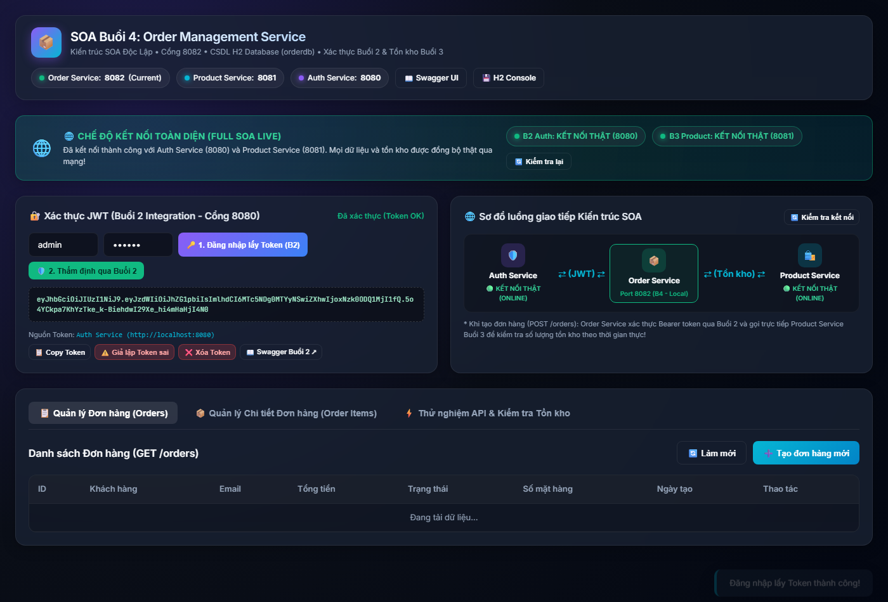
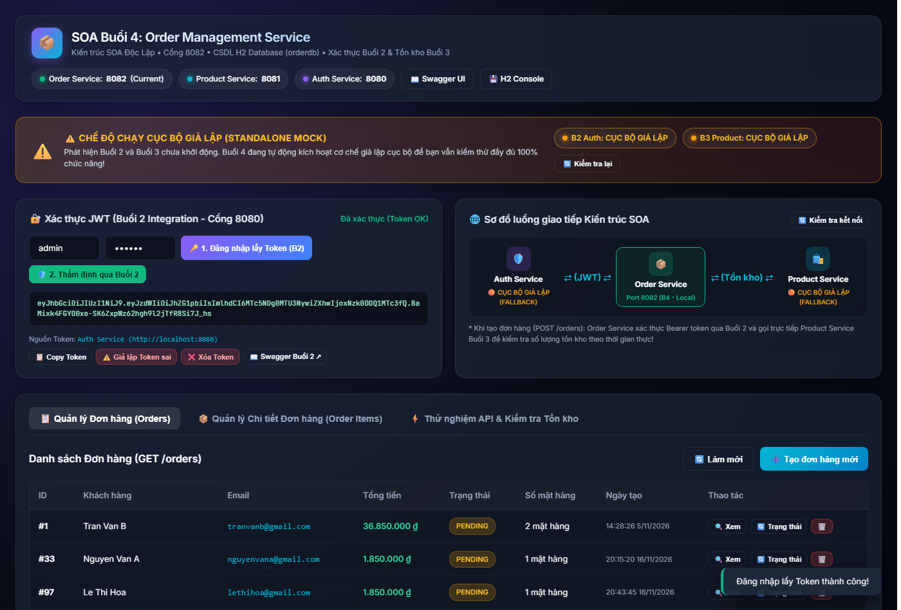

# BÀI THỰC HÀNH SỐ 4: DỊCH VỤ QUẢN LÝ ĐƠN HÀNG (ORDER SERVICE)

Tài liệu này ghi lại chi tiết cách cài đặt, khởi chạy và kiểm thử các chức năng của Bài thực hành số 4 (Order Service), bao gồm cả 2 trường hợp: chạy liên kết với Buổi 2, Buổi 3 và chạy độc lập Buổi 4 khi không mở 2 service trước.

---

## 1. Thông tin dịch vụ

- **Cổng hoạt động (Port):** `8082` (chạy độc lập với Auth Service cổng 8080 và Product Service cổng 8081).
- **Cơ sở dữ liệu:** H2 Database dạng file lưu tại `./data/orderdb`.
- **H2 Console:** `http://localhost:8082/h2-console` (JDBC URL: `jdbc:h2:file:./data/orderdb`, User: `sa`, Pass để trống).
- **Swagger UI:** `http://localhost:8082/swagger-ui/index.html`.
- **Giao diện Web:** `http://localhost:8082/index.html`.
- **Xác thực:** Dùng Token JWT sinh từ API `/login` của Buổi 2 (cổng 8080).
- **Kiểm tra kho:** Gọi API `GET /products/{id}` của Buổi 3 (cổng 8081) để lấy đơn giá và kiểm tra số lượng tồn kho theo thời gian thực.

---

## 2. Cách khởi chạy hệ thống

### Trường hợp 1: Chạy đầy đủ cả 3 bài (Khuyên dùng khi demo chấm bài)

Cần mở 3 terminal để khởi động lần lượt từng dịch vụ:

- **Bước 1: Chạy Auth Service (Buổi 2 - Cổng 8080)**
  ```powershell
  cd "d:\MY STUDY\HK1_4\SOA\buoi_2\demo"
  .\mvnw.cmd spring-boot:run
  ```

- **Bước 2: Chạy Product Service (Buổi 3 - Cổng 8081)**
  ```powershell
  cd "d:\MY STUDY\HK1_4\SOA\buoi_3\demo"
  .\mvnw.cmd spring-boot:run
  ```

- **Bước 3: Chạy Order Service (Buổi 4 - Cổng 8082)**
  ```powershell
  cd "d:\MY STUDY\HK1_4\SOA\buoi_4\demo"
  .\mvnw.cmd spring-boot:run
  ```

*Ghi chú:* Có thể chạy nhanh cả 3 dịch vụ bằng cách chạy file `START_ALL_SOA_SERVICES.bat` ở thư mục gốc.

---

### Trường hợp 2: Chỉ chạy một mình Buổi 4 (Khi không mở Buổi 2 và Buổi 3)

Nếu chỉ tải về hoặc chỉ muốn chạy riêng thư mục `buoi_4`, chỉ cần mở 1 terminal:

```powershell
cd "d:\MY STUDY\HK1_4\SOA\buoi_4\demo"
.\mvnw.cmd spring-boot:run
```

Trong code đã có cơ chế tự kiểm tra kết nối: nếu không thấy cổng 8080 và 8081 hoạt động, service sẽ tự chuyển sang chế độ cục bộ dự phòng (tự sinh token nội bộ và nạp danh mục sản phẩm mẫu để test), giúp toàn bộ các chức năng tạo đơn, tính tiền, kiểm kho vẫn chạy bình thường mà không bị crash.

---

## 3. Hướng dẫn kiểm thử các chức năng

Sau khi chạy service, mở trình duyệt vào địa chỉ: `http://localhost:8082/index.html`.

### 3.1. Kiểm thử khi kết nối đầy đủ Buổi 2 và Buổi 3

Khi cả 3 service cùng chạy, trên đầu trang web sẽ hiện banner màu xanh:  
`CHẾ ĐỘ KẾT NỐI TOÀN DIỆN (FULL SOA LIVE)` và hai nhãn trạng thái `B2 Auth: KẾT NỐI THẬT`, `B3 Product: KẾT NỐI THẬT`.

1. **Test xác thực qua Buổi 2:**
   - Bấm nút "1. Đăng nhập lấy Token (B2)" với tài khoản `admin` / `123456`.
   - Hệ thống sẽ gọi API `http://localhost:8080/login` của Buổi 2 để lấy chuỗi token JWT.
   - Bấm nút "2. Thẩm định qua Buổi 2": hệ thống gửi token sang `http://localhost:8080/auth`, màn hình sẽ báo kết quả từ Buổi 2: `Token hop le! Xin chao: admin`.
   - Nếu bấm "Xóa Token" hoặc "Giả lập Token sai", các thao tác gọi API sẽ bị chặn với mã lỗi `401 Unauthorized`.

2. **Test bắt lỗi khi đặt hàng vượt quá tồn kho:**
   - Mở tab "Thử nghiệm API & Kiểm tra Tồn kho".
   - Bấm nút "Test 3: Bắt lỗi khi ĐẶT QUÁ TỒN KHO" (thử đặt 99999 chiếc).
   - Hệ thống gọi sang Buổi 3 kiểm tra kho và chặn lại với mã lỗi `400 Bad Request`, có thông báo rõ số lượng tồn kho hiện tại không đủ.

3. **Test đặt hàng hợp lệ và tự động trừ tồn kho Buổi 3:**
   - Mở tab "Quản lý Đơn hàng" -> bấm "Tạo đơn hàng mới".
   - Danh sách sản phẩm được tải trực tiếp từ Buổi 3 (cổng 8081).
   - Chọn một sản phẩm (ví dụ: Bàn phím Keychron K2), nhập số lượng là 1 và bấm "Xác nhận Đặt hàng".
   - Đơn hàng được tạo thành công trong bảng `orders` với tổng tiền được tính tự động theo giá từ Buổi 3.
   - Mở lại tab Buổi 3 (`http://localhost:8081/index.html`) tải lại trang sẽ thấy số lượng tồn kho của sản phẩm đó tự động giảm đi 1.

4. **Test hoàn trả tồn kho khi xóa đơn:**
   - Ở bảng danh sách đơn hàng của Buổi 4, bấm nút xóa đơn hàng vừa tạo.
   - Sang lại trang Buổi 3 tải lại, số lượng tồn kho sẽ tự động được cộng trả lại như ban đầu.

---

### 3.2. Kiểm thử khi chỉ chạy độc lập Buổi 4 (Chế độ cục bộ giả lập)

Khi chỉ mở mỗi cổng 8082, trên đầu trang web sẽ hiện banner màu vàng cam:  
`CHẾ ĐỘ CHẠY CỤC BỘ GIẢ LẬP (STANDALONE MOCK)` và hai nhãn trạng thái báo `CỤC BỘ GIẢ LẬP`.

1. **Test đăng nhập:**
   - Bấm nút "Đăng nhập lấy Token": vì Buổi 2 không chạy nên hệ thống tự kích hoạt bộ tạo token JWT nội bộ, cấp token và gán trạng thái đã xác thực.
   - Nếu bấm "Xóa Token", hệ thống vẫn chặn lỗi `401` nếu cố tình gọi API khi chưa có token.

2. **Test tạo đơn hàng:**
   - Bấm "Tạo đơn hàng mới": hệ thống tự nạp danh mục sản phẩm mẫu chuẩn (Laptop Dell XPS 15, Bàn phím Keychron K2, Chuột Logitech MX Master 3S).
   - Chọn sản phẩm và số lượng hợp lệ rồi bấm xác nhận: đơn hàng vẫn được lưu vào CSDL `orderdb`, tính đúng tổng tiền và hiển thị trên bảng danh sách.

3. **Test kiểm tra số lượng:**
   - Thử đặt số lượng lớn vượt quá số lượng mẫu (ví dụ: 99999): hệ thống vẫn bắt lỗi và trả về mã lỗi `400 Bad Request`.

---

## 4. Hình ảnh minh chứng kết quả chạy

### Ảnh 1: Giao diện khi kết nối đầy đủ Buổi 2 và Buổi 3 (Full SOA Live)
Banner xanh báo kết nối thành công với cả Auth Service (8080) và Product Service (8081):



---

### Ảnh 2: Giao diện khi chạy độc lập Buổi 4 (Standalone Fallback)
Banner vàng cam báo đang chạy chế độ cục bộ giả lập do 2 service trước chưa bật, các chức năng tạo đơn và test vẫn hoạt động bình thường:



